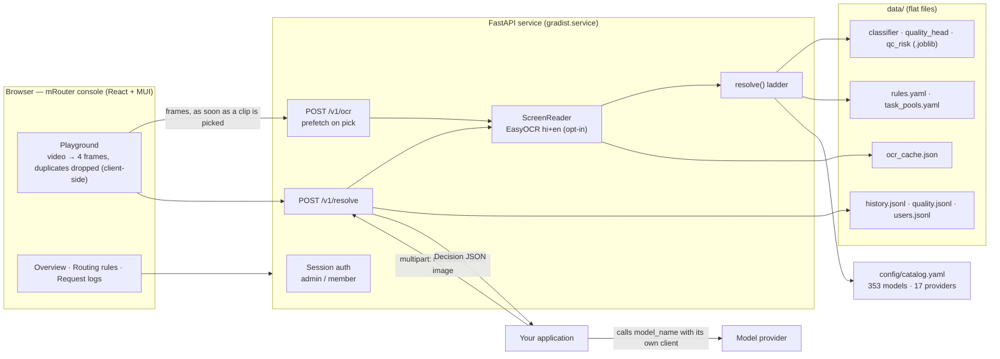
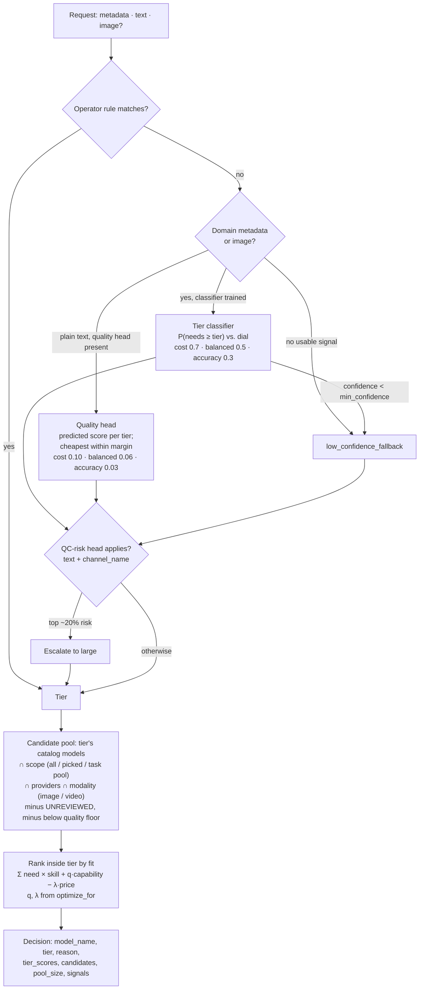
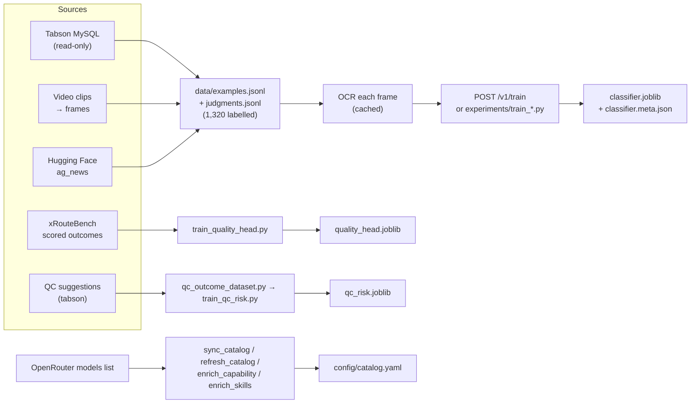

# mRouter architecture

Status: current as of 2026-11-25. For field-level contracts (modules, API, storage) see
[design.md](design.md); for running and operating it see [docs/USER_GUIDE.md](docs/USER_GUIDE.md).

## 1. Problem and scope

Different requests need different amounts of model capability. Sending everything to one model
either overpays for easy requests or loses quality on hard ones. mRouter predicts, **before any
model is called**, how capable a model a request needs, then names the concrete model to use.

**In scope:** reading the request (metadata, text, an image or a video frame, on-screen text),
deciding a tier, picking a model from a multi-provider catalog, explaining the decision, an
operator console, and the offline scripts that train the models it uses.

**Out of scope (by decision):** calling the chosen model, provider API keys, output verification,
retries/failover, cost tracking and tracing. mRouter is the *decision step* in front of whatever
client already calls models. `gradist.llm_stub` is an empty placeholder for a future calling layer
and is not wired to anything.

## 2. System overview

Everything a decision needs is loaded into memory at startup: trained models from `data/`, the
catalog from `GRADIST_CATALOG`, the tier table from `GRADIST_TIERS`. A request makes no network
call (OCR and embeddings run locally on CPU).

## 3. How a decision is made

1. **Rules win.** A rule is an operator's explicit override (`when` metadata → tier, most specific
   wins, optional per-rule `optimize_for`). The learned models never overrule it.
2. **Two learned heads, by request kind.**
   - *Tier classifier* (metadata or media present): features are one-hot metadata with an
     "unknown" bucket per field, a MiniLM text embedding, a 384-d DINOv2 image embedding with a
     has-image flag, and the OCR text appended to the request text when OCR is on. For a video
     the Playground reads up to four frames, drops near-duplicates in the browser (a difference
     hash of the whole picture and of the ticker band), and starts the read via `POST /v1/ocr` as
     soon as the clip is picked; the resolve then finds every frame in the OCR cache. It
     outputs P(needs at least each tier); `optimize_for` sets how sure it must be before moving up.
   - *Quality head* (plain text): trained on outcomes where every tier's models answered the query
     and were scored (xRouteBench). It predicts each tier's score; `optimize_for` sets how much
     quality may be given up for a cheaper tier. Replay on held-out queries versus always-large:
     accuracy ≈ 99.5% quality at 78% cost, balanced ≈ 96% at 66%, cost ≈ 92% at 49%.
3. **Fallback** when nothing can decide, or the classifier is below `min_confidence`.
4. **QC-risk escalation** (newsroom sub-stories): a head trained on which past generations needed
   a QC correction raises the riskiest ~20% to `large`. It only ever raises a tier.
5. **Catalog pick.** Within the tier the candidate pool is filtered (scope, provider, media,
   quality floor, context window ≥ input), then ranked by fit to the request's skill needs
   (`fit.py`): Σ need × model skill + q × capability − λ × price, where `optimize_for` sets q and
   λ, and q is scaled by 0.5 + the request's difficulty (`skills.py`: the largest of QC risk,
   length, figures and conditions in the text, 0.25 for a short plain request; unscaled when none
   applies). Model skills are scaled 0–1: declared video/audio support, the multilingual index for
   Hindi, capability for reasoning and writing, context window (log, 8K–1M) for long input, and
   cheapness for speed; price is a fixed log scale, so a gap weighs the same in a two-model pool
   as in the whole catalog. Capability is OpenRouter's Artificial Analysis intelligence index (91
   models measured); the other 262 are estimated from log price and release date, shown with
   `~`, and counted at 85%. Human quality ratings, keyed by `GRADIST_QUALITY_FIELD`, replace
   capability where present.
6. **Feedback loop.** Every decision has a `request_id`, and history keeps that request's skill
   needs. A rating given with the `request_id` (Playground or Request logs) is stored with those
   needs; `feedback.py` turns all such ratings into per-model skill evidence, weighted by need,
   and blends it with the catalog value, which counts as 3 ratings. The next pick ranks with the
   learned skills (marked `*` in the shortlist, with prior → learned and the rating count).
   Price-based speed is never learned, and ratings cannot grant video or audio support.
   Three more reviews are collected for learners that are not built yet (`reviews.py`):
   "What went wrong?" skills on a rating, comparisons of the pick with another model
   (`preferences.jsonl`), and corrected needs (`need_labels.jsonl`). None of them affect picks yet.

### Explainability

The decision returns what was read and why: `signals` (text length, metadata used/ignored, image
bytes, modality, providers, `screen_text` lines from OCR) and, when the classifier decided,
`signals.classifier_inputs` — each metadata value and whether training had seen it, the embedders
and their sizes, and the tier odds recomputed **without the image / text / screen text /
metadata**, so the console can show which input moved the decision. `tier_scores` and the top-8
`candidates` show the evidence for the tier and the model. `signals.skill_needs` (from
`skills.py`) scores how much the request needs each skill — video, audio, Hindi, reasoning, long
input, writing, speed — with a reason per score, from the task profile in
`config/task_skills.yaml`, the modality, Devanagari in the text or screen text, the QC-risk score
and the input length. Each shortlisted candidate carries its `fit` and the term-by-term
`fit_parts`, and the reason names the winner's largest terms.

## 4. Training pipeline (offline)

Labels come from two places: rule-derived seed labels and human judgments (the Judging screen,
now hidden from the sidebar but still served by the API). The service reloads every artefact
from `data/` on start; retraining is needed only when examples or judgments change. Retraining
with OCR reads only new frames — the first OCR pass over 120 frames took ~16 minutes on CPU;
cached retrains take ~2 minutes.

## 5. Key decisions

| Decision | Why |
|---|---|
| Decide only, never call the model | Keeps the router provider-agnostic and keyless; the calling client (LiteLLM, LangChain, an SDK) is a separate, swappable layer. |
| Abstract tiers, not model names, in the learned heads | Retraining is needed when the *task* changes, not when the model lineup changes; the catalog maps tiers to today's models. |
| Rules always win | An operator must be able to pin a channel or task without retraining. |
| Separate heads for plain text vs. domain requests | Generic text quality is learnable from public scored outcomes; channel/video routing needs in-house labels. |
| `optimize_for` as one dial for tier *and* model | One user-facing choice; the same intent applies to "move up a tier?" and "which model in it?". |
| Video never uploaded | The browser extracts a single frame; only that frame and `modality=video` reach the API. |
| EasyOCR, opt-in (`GRADIST_OCR=1`) | Apache-2.0, Devanagari + Latin, fully local; ~8 s/frame on CPU, so it is off unless asked for and results are cached. |
| DINOv2 for images, MiniLM for text | Permissive licences, small enough for CPU; CLIP checkpoints without a clear licence were rejected. |
| Flat files, single process | One deployment = one data directory, catalog and rule set; enough for the current load, trivial to back up. |
| Session cookies, admin/member roles | Every write needs a signed-in user; managing users and assigning catalog tiers needs an admin. |

## 6. Known limitations

- **Video always routes to large today.** All 120 labelled video frames are labelled `large`, so
  the image dominates and text cannot move it. More varied frame labels are the fix; the
  `without_image` evidence in each decision shows this directly.
- **OCR did not improve held-out accuracy** (`experiments/eval_ocr.py`: 0.974 with and without),
  for the same reason. It stays on because it is cached and adds evidence operators can read.
- **QC-risk escalation** applies only to requests shaped like tabson sub-stories (`channel_name`
  plus text).
- **Capability is estimated for 262 of 353 models**; human ratings are the remedy for models
  that matter.
- **No multi-tenant isolation**: run separate deployments for separate products.
