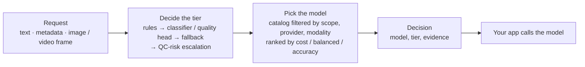

# mRouter

mRouter decides **which model should handle a request** — before any model is called. It reads
the request (text, metadata, an optional image or video frame), decides how capable a model it
needs (**small / medium / large** tier), then picks a concrete model from a catalog of 353 models
across 17 providers, ranked for **cost**, **balanced** or **accuracy**. Your application calls the
chosen model; mRouter never does.



- **Content decides the tier.** Plain text goes to a quality head trained on scored model
  outcomes; requests with metadata or media go to a classifier over metadata, text embedding,
  image embedding and on-screen text (OCR). Operator rules override both.
- **You choose the trade-off.** `cost` moves up a tier only when fairly sure, `accuracy` on a
  real chance; inside a tier, `cost` takes the cheapest model, `accuracy` the highest benchmark
  capability, `balanced` the cheapest above the tier's median.
- **Every decision is explained.** Tier odds, the shortlist inside the tier, exactly what was
  read from the request (including the frame and its OCR text), and which input moved the tier.
- **Video stays local.** The browser extracts one frame; the clip is never uploaded.

## Quick start (Windows)

```powershell
python -m venv .venv
.\.venv\Scripts\pip install -e ".[service,embeddings,images,ocr,dev]"
cd ui; npm install; cd ..
# .env needs at least GRADIST_SESSION_SECRET and GRADIST_TIERS — see docs/USER_GUIDE.md
.\.venv\Scripts\python -m gradist.service.bootstrap --username <admin>
.\scripts\start.ps1          # API on :8000, console on :5174
```

Open <http://localhost:5174>, sign in, and use the **Playground**. The internal package and
environment variables keep their original name, `gradist` / `GRADIST_*`.

## Documentation

| Document | What it covers |
|---|---|
| [docs/USER_GUIDE.md](docs/USER_GUIDE.md) | Running, configuring, the console, calling the API, retraining |
| [ARCHITECTURE.md](ARCHITECTURE.md) | How a decision is made and why it is built this way (diagrams) |
| [design.md](design.md) | Reference: modules, data shapes, storage layout, full API |

The console's **Documentation** page (user menu) carries the same guide.

## Layout

```
llm-tier-router/
├── src/gradist/            library: features, classifier, quality head, QC risk, OCR, catalog, resolve
│   └── service/            FastAPI app, auth, flat-file store
├── ui/                     React + MUI console (mRouter)
├── config/                 tiers*.yaml, catalog.yaml (353 models), catalog.example.yaml
├── experiments/            training, catalog sync/enrichment, evaluation scripts
├── scripts/start.ps1       starts API + console from .env
├── tests/                  pytest suite
└── data/                   (gitignored) examples, judgments, trained models, history, users
```

## Using it from another service

Call `POST /v1/resolve` and use `model_name` from the response with your own provider client —
see [docs/USER_GUIDE.md](docs/USER_GUIDE.md#integrate-from-another-app). mRouter holds no provider
API keys. The library (`src/gradist/`) can also be imported directly; nothing in it is specific
to one company's channels or models.
