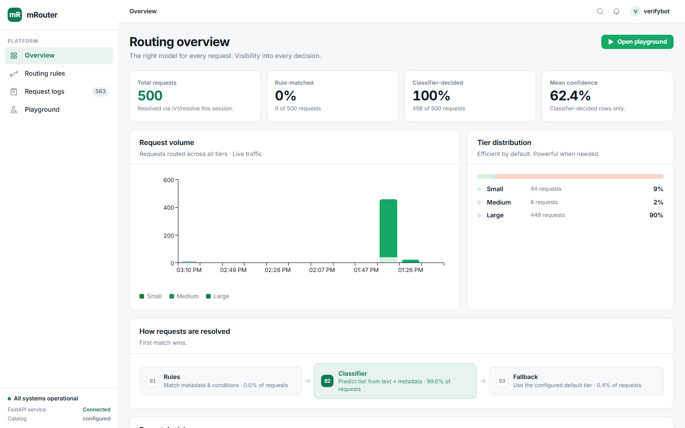

# mRouter user guide

mRouter picks a **model tier** and a concrete **model name** for a request. It does **not** call
the model — your application does that with the `model_name` returned by `/v1/resolve`. The code
package and settings keep their original name (`gradist`, `GRADIST_*`).

The in-app **Documentation** page (user menu) carries the same guide. Screenshots live in
`docs/images/` and `ui/public/docs/images/`.



## Where it is useful

- Workloads with stable metadata (`task`, channel, content type, …) that should map to tiers.
- Cost-first routing by default, accuracy-first where it matters.
- Video and image work: the frame, its on-screen text and the channel all inform the tier.
- Audit: every decision is stored with its evidence and can be rated.

If you only use one model, or need a streaming proxy with provider failover, mRouter is the
decision step in front of that — not the proxy itself.

## How a request is resolved

1. **Rules** — metadata match → tier (+ optional per-rule `optimize_for`). Rules always win.
2. **Classifier** — requests with an image or domain metadata: gives P(needs at least each tier);
   `optimize_for` takes the highest tier whose chance clears its threshold (cost 70%, balanced
   50%, accuracy 30%). Metadata fields it was not trained on are listed in
   `signals.metadata_ignored`.
3. **Quality head** — plain-text requests: predicts each tier's score and takes the cheapest tier
   within the `optimize_for` margin (accuracy 0.03, balanced 0.06, cost 0.10).
4. **Fallback** — otherwise, or below `min_confidence`, the configured fallback tier.
5. **QC-risk escalation** — requests with text and `channel_name`: the riskiest ~20% of
   sub-stories are raised to `large`. Never lowers a tier, never overrides a rule.
6. **Catalog pick** — models in the tier that pass the scope, provider, media and quality filters,
   and whose context window holds the input, are ranked by **fit to what the request needs**:
   Σ need × skill + q × capability − λ × price (see below). `optimize_for` sets the weights:
   `cost` q 0.1 / λ 1.0, `balanced` 0.6 / 0.6, `accuracy` 1.0 / 0.2. The request's
   **difficulty** (0–1) scales q by 0.5 + difficulty, so two requests with the same needs can get
   different picks: a short plain request (0.25) leans toward price, one with many figures,
   conditions, a long input or a high QC-risk score leans toward capability. With no such signal q
   is unchanged. The Playground shows it under the needs. A model's skills are
   video/audio support, the Hindi (multilingual) score, capability for reasoning and writing
   (a human quality rating replaces it where present), context window for long input, and
   cheapness for speed. Capability is the Artificial Analysis intelligence index from OpenRouter
   where measured, otherwise estimated from price and release date (shown with `~`); estimated
   skills count at 85%. Models marked `UNREVIEWED` are never selected.

`provider` accepts one or several comma-separated providers (`anthropic,google`). The scope can
be the whole catalog, a hand-picked list (`selected_models`) or a named task pool (`task`).

### What the router reads

- **Metadata** — each trained field; unseen values fall into an "unknown" bucket.
- **Text** — a sentence embedding (MiniLM).
- **Image / video frame** — a 384-number DINOv2 fingerprint of the frame's look. A video is never
  uploaded: the browser sends one still plus `modality=video`, which limits the pick to models
  that accept video.
- **On-screen text** — with `GRADIST_OCR=1` (and the `ocr` extra installed) the frame is read with
  EasyOCR in Hindi + English (`GRADIST_OCR_LANGS` for others); lines are returned in
  `signals.screen_text`, cached in `data/ocr_cache.json`, and used in training
  (`reads_screen_text` in `classifier.meta.json`). The first read of a frame takes ~5–8 s on CPU.
  For a video the Playground reads up to four frames (10%, 35%, 60% and 85% into the clip) and
  merges their lines. Frames whose picture and bottom ticker band both match an earlier one are
  skipped, and the read starts the moment the clip is picked (`POST /v1/ocr`), so by the time
  you press **Pick best model** the frames are cached and the pick takes well under a second.
- **Recorder file names** — `1010013_2026.07.28_07.40.00-….mp4` fills `channel_code` and the
  channel's name, network, type and genre (from `GET /v1/channels`) in the Playground, without
  overwriting anything you typed.

Every decision also says **what the request needs**: `signals.skill_needs` scores seven skills
from 0 to 1 (video watching, hearing speech, Hindi, reasoning, long input, writing, quick and
cheap), each with its reason, e.g. `modality=video (1.0)`, `Devanagari in screen text (1.0)`,
`task profile v3_single (0.9)`. Task profiles live in `config/task_skills.yaml`. The Playground
shows them under **What this request needs**, and the shortlist shows each model's fit and what
added to it, e.g. `video +1.00 · audio +0.80 · hindi +0.79~ · price −0.25`.

**Feedback loop.** Rate a pick (1 = wrong, 5 = right) under **Rate this pick** in the Playground
or with **Rate** in Request logs. The rating is stored with that request's skill needs and moves
the model's skills the request needed, weighted by need, toward what you saw. The catalog value
counts as 3 ratings, so one 1/5 on a Hindi request moves a 0.90 Hindi score to 0.68 and three
move it to 0.45. The shortlist marks a moved skill with `*` and shows the change, e.g.
`hindi +0.68* (0.90→0.68, 1 rating)`. Speed (price) is never learned, and ratings never give a
model video or audio support it lacks. Members can rate only their own requests.

To give a review:

1. **Playground:** resolve a request, check the model's real output, then pick stars under
   **Rate this pick** and press **Save rating**. Press **Pick again** to resolve the same request
   with the rating applied. **Moved by ratings** lists each model whose skills ratings changed,
   with its new rank, even when it has dropped out of the top of the shortlist.
2. **Request logs:** select a row and press **Rate** (it becomes **Rate again** once you have
   rated it). Rated rows show their average stars. The details panel shows **What this request
   needed** (the skills a rating will move) and every rating with who gave it.

With 3 stars or fewer, **What went wrong?** lets you tick the skills the output got wrong.

**Similar reviewed requests.** Ratings and comparisons also count for requests like the one
reviewed, not only through skills. For a new request, the 5 most similar reviewed requests
(similarity ≥ 0.3) vote for each model they rated: −1 (all 1/5) to +1 (all 5/5), shrunk when
few agree. A comparison counts as 5 for the winner and 1 for the loser. The vote adds
0.5 × vote to the fit as `similar`. It switches on by itself once 50 requests have been
reviewed and, holding each one out, the votes agree with its review at least 60% of the time.
Until then the Playground's **Similar reviewed requests** section says why it is off, e.g.
`off: 12 of 50 reviewed requests`. `GRADIST_NEIGHBOURS=on` or `off` overrides that.

Two more reviews are stored and shown on the request:

- **Compare** (Request logs): run the request on the pick and on another model outside the
  router, then record which output was better, or "Same", and optionally where the difference
  showed. The other model defaults to the runner-up from that request's shortlist. Comparisons
  feed the similar-request votes below.
- **Correct these needs** (Playground, next to the needs): set what the request really needed,
  per skill. The rules' values are kept alongside, so the correction can be learned. It does
  not change picks yet.

The decision returns `tier_scores`, the top-8 `candidates`, `pool_size` and `signals`. When the
classifier decides, `signals.classifier_inputs` lists exactly what it read and the tier odds
**without** the image, text, screen text or metadata — the Playground shows this as "What moved
the decision".


## Run locally

1. Install: `pip install -e ".[service,embeddings,images,ocr]"` in a virtualenv, and `npm install`
   in `ui/`.
2. Create `.env` (gitignored) — see the table below. `ui/.env.local` must point `VITE_API_BASE`
   at `http://localhost:8000`.
3. Create the first user: `python -m gradist.service.bootstrap --username <name>` (prompts for a
   password; `--role member` for non-admins, `--reset <name>` to reset a password).
4. Run `scripts\start.ps1`: API on port 8000, console on 5174, each in its own window.

Trained models (`classifier`, `quality_head`, `qc_risk`) are reloaded from `data/` on every start;
`POST /v1/train` is only needed after examples or judgments change.

| Variable | Required | Purpose |
|---|---|---|
| `GRADIST_SESSION_SECRET` | yes | Signs session cookies — `python -c "import secrets; print(secrets.token_urlsafe(48))"` |
| `GRADIST_TIERS` | yes | Tier table, e.g. `config/tiers.general.yaml` |
| `GRADIST_CATALOG` | no | `config/catalog.yaml` (353 models, 17 providers) |
| `GRADIST_DATA` | no | Store directory, default `data` |
| `GRADIST_QUALITY_FIELD` | no | Field that buckets quality ratings, e.g. `task` |
| `GRADIST_CORS_ORIGINS` | no | Console origin, default `http://localhost:5174` |
| `GRADIST_RULES_SEED` | no | Rules file copied in while the store has none |
| `GRADIST_ALLOW_READ_WITHOUT_AUTH` | no | `1` opens GET endpoints for monitoring |
| `GRADIST_OCR`, `GRADIST_OCR_LANGS` | no | `1` turns on screen-text reading; languages default `hi,en` |
| `GRADIST_TASK_SKILLS` | no | Skill needs per task, default `config/task_skills.yaml` |
| `GRADIST_NEIGHBOURS` | no | Similar-request votes: `auto` (default), `on` or `off` |

## Integrate from another app

```bash
curl -c cookies.txt -X POST http://localhost:8000/v1/auth/login \
  -H "Content-Type: application/json" \
  -d '{"username":"svc","password":"..."}'

curl -b cookies.txt -X POST http://localhost:8000/v1/resolve \
  -F 'metadata={"channel_code":"1010013","modality":"video"}' \
  -F 'text=summarise the bulletin' \
  -F 'image=@frame.jpg' \
  -F 'optimize_for=balanced'
```

```python
import httpx

with httpx.Client(base_url="http://localhost:8000", timeout=60.0) as client:
    client.post("/v1/auth/login", json={"username": "svc", "password": "..."})
    decision = client.post(
        "/v1/resolve",
        data={"metadata": '{"task":"news"}', "text": "...", "optimize_for": "balanced"},
    ).json()
    model = decision["model_name"]   # call your provider with this
```

mRouter holds no provider API keys. The full API is in [design.md](../design.md#api) and at
<http://localhost:8000/docs>.

## Console map

| Where | Screen | Purpose |
|---|---|---|
| Sidebar | Overview | Volume, tier mix and how decisions were made (your own requests; admins see all) |
| Sidebar | Routing rules | Metadata → tier overrides; always win |
| Sidebar | Request logs | Your decisions for audit; rate model output. Admins see every operator's, with a "Requested by" filter |
| Sidebar | Playground | Try a resolve with metadata, text, image or video |
| User menu | Documentation | This guide |
| User menu | Settings | Live deployment facts (no secrets) |
| User menu | Operators | Admins: who may sign in |

The training screens (Examples, Human judging, Train, Evaluate) are hidden from navigation; their
endpoints remain for scripted retraining.


## Retraining and catalog upkeep

| Script (`experiments/`) | Does |
|---|---|
| `train_from_tabson_db.py`, `train_from_video_clips.py`, `train_from_hf_content.py` | Build labelled examples and fit the classifier |
| `eval_ocr.py` | Held-out accuracy with vs. without OCR |
| `train_quality_head.py` (after `probe_xroutebench.py`) | Fit the plain-text quality head |
| `qc_outcome_dataset.py` → `train_qc_risk.py` | Fit the QC-risk escalation head |
| `sync_catalog.py --add-new` | Import new OpenRouter models as `UNREVIEWED` |
| `refresh_catalog.py`, `enrich_capability.py` | Refresh prices/modalities and capability scores |
| `enrich_skills.py` | Hindi/multilingual score (measured or estimated) and structured-output support per model; run after `enrich_capability.py` |

## Known limitations

- All labelled video frames are `large`, so video currently always routes to `large`; more varied
  frame labels are needed before the image can choose a smaller tier.
- One process = one data directory, catalog and rule set; run separate deployments for separate
  products.
